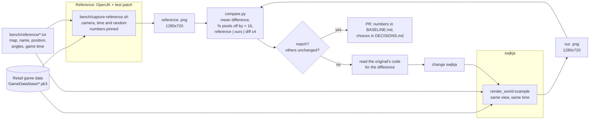
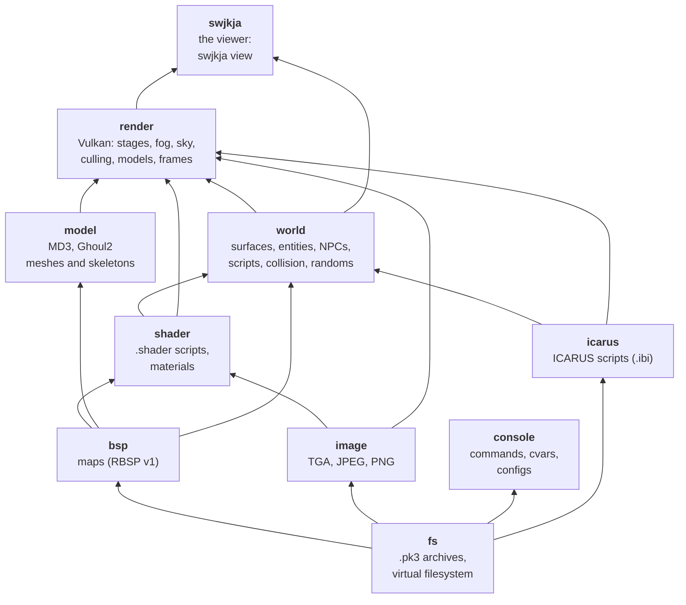
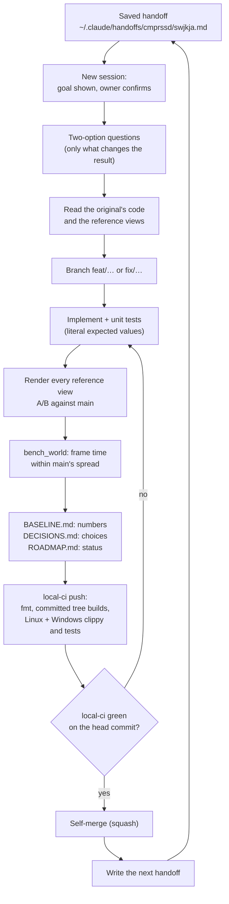
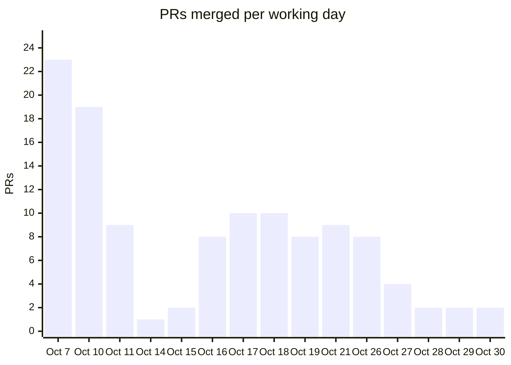
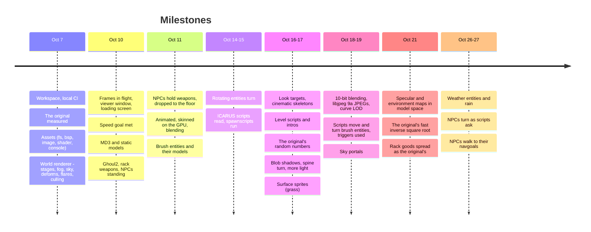
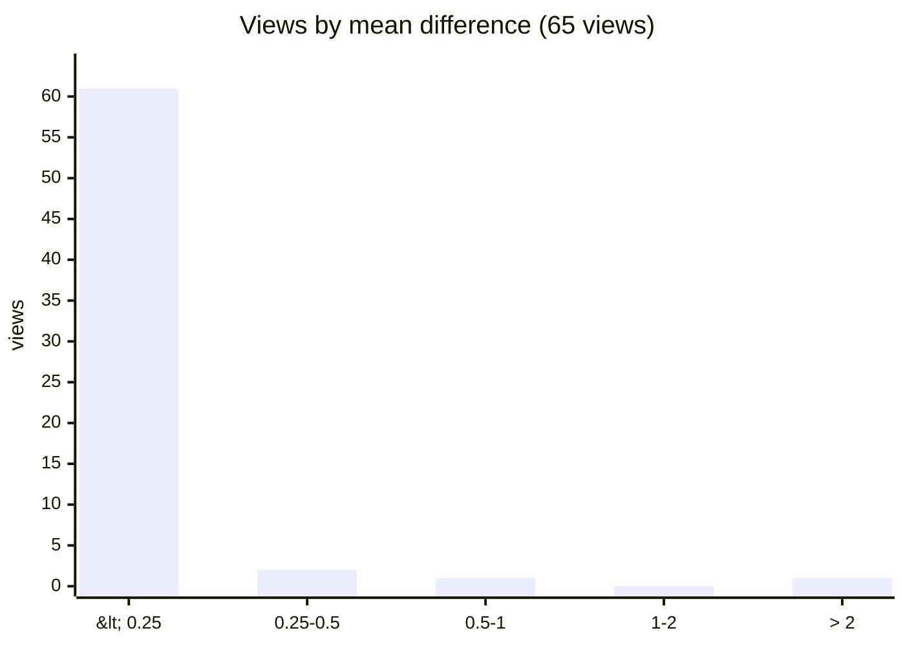
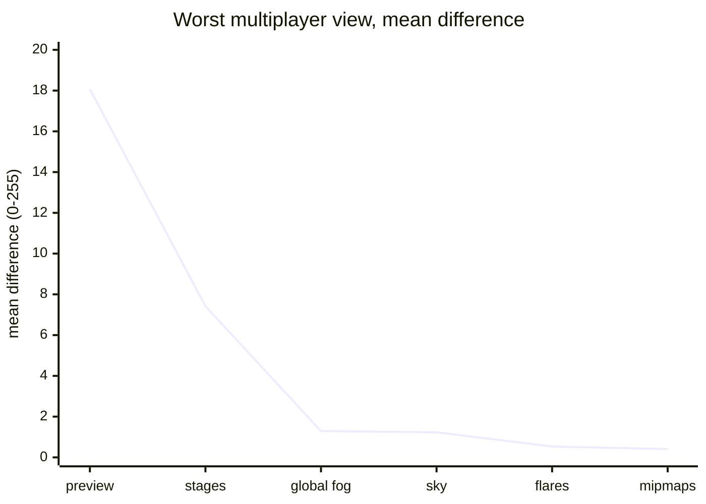

# How swjkja works

A guided tour of the project: what it builds, how the code is laid out, how every
change is proven against the original game, and how the work itself is run.
[BASELINE.md](BASELINE.md) holds every measurement in full and
[DECISIONS.md](DECISIONS.md) every choice with its reason. The pictures and videos
of the same story, before and after, are on the [progress page](#progress-page).

<!-- progress:asof -->
Numbers in the generated parts below are as of 2026-10-30 (117 merged PRs), counted
by `scripts/progress.py`.
<!-- /progress -->
The hand-written parts (speed, the retail files read) give their own dates.

## What it is

swjkja is a new engine for **STAR WARS Jedi Knight: Jedi Academy** (2003), written in
Rust. It reads the player's own copy of the game (`GameData/base/*.pk3`) and aims to
show the same game, pixel for pixel, while running faster, especially on weak
hardware like the integrated GPU it is developed on (Intel HD Graphics 630).

It is a port, not a remake. Raven Software released the game's source under GPLv2 in
2013, and the community's fork, **OpenJK** (pinned at `260c59c`, about a million lines
of C/C++), is the *reference*: for each feature, the original's code is read
function by function (`R_SetupEntityLighting`, `BG_EvaluateTrajectory`,
`CSequencer::CheckRun`, ...) and its rules are carried over, including its quirks,
since a quirk changes what is on screen.

## The idea in one picture

The project's core is a closed loop: the original engine and the new one render the
same pinned view, and a script measures how far apart the two images are. A feature
is done when its views match and no other view moved.

The reference build carries a test-only patch (`bench/reference/openjk-view.patch`,
523 lines) that makes its screenshots reproducible: the camera placed exactly
(`cg_swjkjaView`), the game time stopped at the view's time (`cg_swjkjaTime`), the
NPCs' AI frozen while their scripts run, and script random numbers pinned
(`g_swjkjaScriptRand`). It can also log what the original computes (random draws,
animation frames, look angles), so a difference can be traced to the exact number
that differs instead of being guessed at from pixels.

## Architecture

<!-- progress:code -->
10 crates in one Cargo workspace, 41,260 lines of Rust (sources, tests and examples)
plus 630 lines of WGSL shaders, 360 tests. Each crate maps to one part of the
original engine.
<!-- /progress -->

<!-- progress:crates -->
| Crate | Rust lines | Tests | What it does | The original's counterpart |
|------|------:|------:|------|------|
| `fs` | 905 | 13 | `.pk3` (zip) archives, the search order across them | `files.cpp` |
| `bsp` | 1,113 | 9 | parses and cross-checks the 57 retail maps | `tr_bsp.cpp`, `cm_load.cpp` |
| `image` | 1,936 | 17 | decodes textures as the original does | `tr_image*.cpp` |
| `console` | 1,011 | 12 | command buffer, cvars, config files | `cmd.cpp`, `cvar.cpp` |
| `icarus` | 307 | 1 | reads compiled ICARUS scripts | `icarus/` |
| `shader` | 3,134 | 28 | `.shader` scripts and which material a surface draws | `tr_shader.cpp` |
| `model` | 2,534 | 32 | MD3 and Ghoul2 (`.glm`/`.gla`) meshes, skins, animation | `tr_model.cpp`, `ghoul2/` |
| `world` | 16,642 | 157 | patches, stitching, light grid, entities as they spawn, NPCs, scripts, box traces, shadows, the game's random numbers | `tr_curve.cpp`, `g_*.cpp`, `NPC_*.cpp`, `Q3_Interface.cpp` |
| `render` | 12,728 | 84 | Vulkan renderer: materials stage by stage, fog, sky, deforms, flares, culling, models skinned on the GPU, frames in flight | `tr_*.cpp` (the vanilla renderer) |
| `swjkja` | 950 | 7 | the map viewer window and its loading screen | `cl_*.cpp` (a small part) |
<!-- /progress -->

The tests that read retail data run on the Windows side against the owner's install,
and every retail file of each kind is checked, not a sample (see below).

## The process

The owner steers; Claude (Claude Code) does the engineering, one task per session.

Rules that shape it:

- **Two-option questions.** Before building, Claude asks the owner only what changes
  the result (for example "check with a new pistol-stance view" or "only the existing
  ones"), with a recommendation. Choices that come up mid-build are made by Claude,
  marked *decided by Claude, pending review* in DECISIONS.md, and listed in the PR.
  <!-- progress:process -->
  So far: 80 decision entries, 15 chosen by the owner, 61 made by Claude for review.
  <!-- /progress -->
- **$0 development.** No GitHub Actions: `.local-ci` runs on this machine (format,
  shell syntax, a build of exactly the committed tree, then clippy and tests on
  Linux/WSL and on Windows/MSVC in parallel) and posts a `local-ci` status to the
  PR. A PR merges only when that status is green on its head commit.
- **Proof against the real thing.** A change counts when its reference views move
  the right way, the other views render pixel for pixel as on main, and the frame
  time stays within main's spread. What wasn't verified is said so in the PR and in
  BASELINE.md.
- **Game windows only with permission.** Capturing references and timing the
  original open a game window on the owner's PC, so scripts refuse while the PC is
  in use, and Claude asks first.
- **Short sessions, saved handoffs.** Each session ends with a self-contained prompt
  for the next one, so context is rebuilt from the docs, not from a long chat.

## Statistics

### History

<!-- progress:history -->
132 commits, 117 merged PRs from 2026-10-07 to 2026-10-30, on 15 working days: 66
feat, 34 fix, 10 docs, 4 bench, 2 chore, 1 ci. About 56,471 lines added and 4,452
removed; 158 tracked files.

<!-- /progress -->

### Every retail file, read

| What | Count | Result |
|------|------:|------|
| Files in the `.pk3` archives | 22,775 (3,049 MB) | all read, every CRC-32 checked |
| Maps | 57 (521 MB) | all parse, every cross-reference checked, 15-24 ms each |
| Textures | 5,875 | all decode; TGA and PNG identical to reference decoders, JPEG identical to OpenJK's libjpeg 9a |
| Shader definitions | 3,365 in 68 files | all parse in 9-11 ms; the 40 the original rejects are the editor-only ones |
| Map surfaces | 57 maps | built in 1.20 s total |
| MD3 and Ghoul2 models, ICARUS scripts | every retail file | load, pinned by tests |

### How close the pictures are

<!-- progress:views -->
65 reference views, 1280x720, rendered by both engines and compared (mean absolute
difference per channel, 0-255; measured 2026-10-30 at PR #119):

| Kind | Views | Mean difference |
|------|------:|------|
| Multiplayer world (sky, fog, fog volumes, flares, animated stages, curve LOD) | 19 | 0.00-0.03 |
| Static and brush-entity models, rotating fans and drums | 18 | 0.00-3.73 |
| Single-player NPCs (spawned, scripted, turned, walked) | 28 | 0.00-0.46 |
| **All** | **65** | **median 0.01; 63 under 0.5, 64 under 1.0** |

The largest: ffa5_pipes (3.73), hevil_fan_west (0.63), academy2_students_walking
(0.46).
<!-- /progress -->

Explained, and not renderer errors: ffa5_pipes has the original's first-person
lightsaber, which its `cg_drawGun 0` doesn't hide; hevil_fan_west shows the effects
(`fx_runner`, t3_hevil's dust) swjkja doesn't draw yet; academy3_luke_walking is
Luke's stride mid-walk, his cinematic animation starting 36 ms apart (BASELINE.md,
2026-10-27). danger_rock's distant peaks (5.19 until 2026-10-19) were its sky
portal's scene.

How the world views got there, step by step (the worst of the first 11 multiplayer
views, on 2026-10-07 and 2026-10-10):

### How fast

The same recorded ffa3 camera path (1,182 frames, world only), both engines,
1280x720 on the Intel HD Graphics 630, three alternating runs each (2026-10-10):

| Run | The original (OpenJK) | swjkja | Ratio |
|------|------:|------:|------:|
| Idle PC, window | 265-271 FPS | 281-285 FPS | 1.04-1.08x |
| Idle PC, exclusive fullscreen | 279-290 FPS | 306-329 FPS | 1.05-1.18x |
| Busy PC, window | 108-137 FPS | 158-159 FPS | 1.15-1.45x |
| Busy PC, fullscreen | 143-159 FPS | 192-209 FPS | 1.2-1.45x |
| Offscreen (no presenting) | 233-242 FPS | 399-404 FPS | 1.4-1.7x |

swjkja's worst frames are 8-23 ms against the original's 27-31 ms on the idle PC.
The original is bound by its single CPU thread, so it loses the most when the PC
is busy. A map's textures load in 0.4-0.5 s (best case), and the viewer shows its
first frame 0.26-0.35 s after the window opens, while the map loads behind a
progress bar.

## Where it is going

From [ROADMAP.md](ROADMAP.md):

| # | Milestone | State |
|---|------|------|
| 0 | Baseline: the original's numbers | multiplayer done; single-player and full-game frame spikes pending |
| 1 | Assets | done |
| 2 | Map viewer | done, speed goal met |
| 3 | Models: Ghoul2, MD3, skins, sabers, effects | in progress: NPCs spawn, animate, run their scripts, look, cast shadows, open the doors they stand in, turn and walk to their navgoals as scripts ask; scripts move brush entities; next: NPCs' walk and run animations, then the rest of their AI |
| 4 | Single-player: collision, movement, entities, scripts, AI, sound, UI, saves | partly started (scripts, traces) |
| 5 | Multiplayer: protocol, server, client, bots | not started |
| 6 | Mods | not started |

## Progress page

The [progress page](https://cmprssd.github.io/swjkja/) tells the same story in
pictures. It is served from the `gh-pages` branch, which holds the page alone, so the
game's imagery stays off main:

- **Before and after:** the history views (`bench/reference/history-views.txt`) as
  each milestone's build drew them (`bench/reference/milestones.txt`, rendered by
  `bench/history.sh`), against the original, with a slider and each build's score.
- **Every reference view:** the original's screenshot, swjkja's render and their
  difference, with compare.py's scores.
- **Videos:** the ffa3 demo's camera path and academy3's Luke walking to his navgoal
  (`bench/progress-media.sh`).
- **The numbers:** PRs per day, Rust lines and tests after every PR, crates, speed.

`scripts/progress_page.py` builds it from these and from `scripts/progress.py`'s
counts, and `scripts/publish-progress.sh` publishes it after each merge (see
CLAUDE.md).

## Reproducing the numbers

    cargo test --workspace                                    # Linux
    scripts/cargo-msvc.sh run --release --example render_world <GameData> <views.txt> <out>
    uv run --with numpy --with pillow python bench/reference/compare.py <ref> <out> <diff>
    bench/capture-reference.sh <views>                        # opens a game window
    bench/path-reference.sh                                   # times the original

Each command's details, and the history behind every number above, are in
[BASELINE.md](BASELINE.md).
